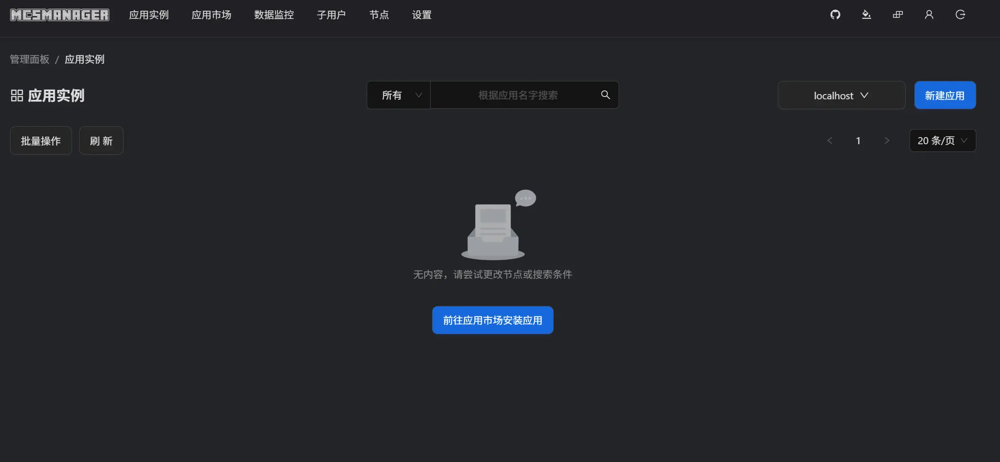
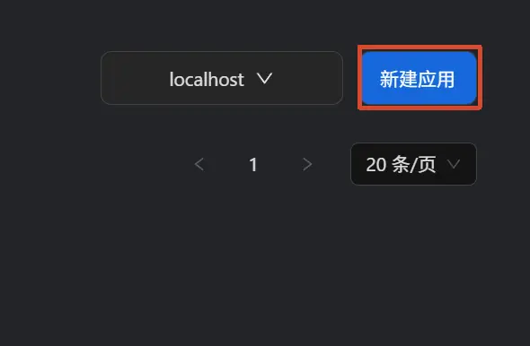
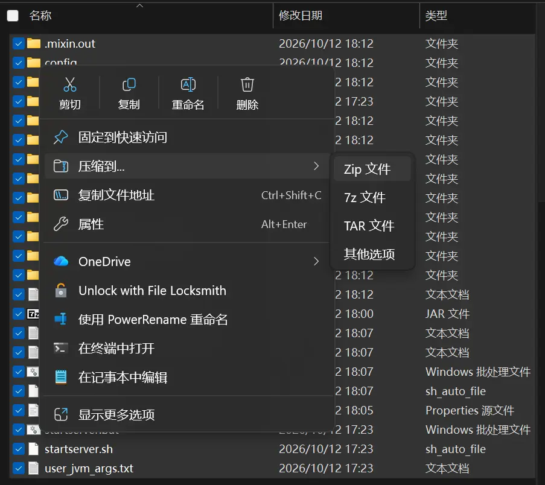
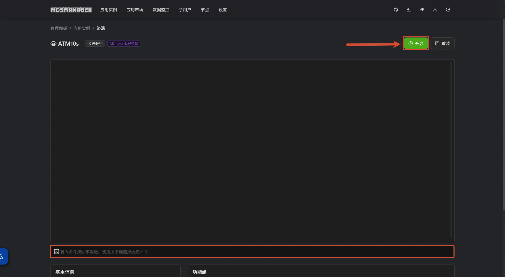

import MultipleChoice from '../../../../components/tutorial/MultipleChoice.astro';
import Option from '../../../../components/tutorial/Option.astro';
import Box from '../../../../components/tutorial/Box.astro';

## 一. 认识Minecraft服务器

无论你是否了解 Minecraft 服务器，这篇教程都会带你快速上手开设 Java 版服务器，供社团或朋友一起游玩。不要担心，这很简单！

### 1.1 什么是Minecraft服务器？

> Minecraft服务器（Minecraft Server）可以使玩家在线或通过本地局域网络和其他玩家一起玩Minecraft。在游戏内部，游戏为单人游戏运行服务器，这样做是为了使单人游戏体验与多人游戏体验保持一致，并使得对游戏所做的更改（例如错误修复）既适用于单人游戏又适用于多人游戏。    --Minecraft WIKI

Minecraft 的单人和服务器世界都运行在服务器上，但两者仍有区别，尤其在非原版环境中。遇到异常问题时，别忽略这一点。

<Box icon="question-mark">

**Minecraft 单人游戏是否也运行在服务器上？**

<MultipleChoice>
  <Option>
    <span>只有多人模式使用服务器。</span>
    <span slot="feedback">再想一想：单人游戏也会运行内部服务器。</span>
  </Option>
  <Option isCorrect>
    <span>单人和服务器世界都使用服务器，但两者仍有区别。</span>
    <span slot="feedback">正确！单人游戏也运行在服务器上，但不能忽略它与服务器世界的区别。</span>
  </Option>
  <Option>
    <span>两种模式的运行方式完全一致，没有任何区别。</span>
    <span slot="feedback">两者都使用服务器，但原文提醒它们仍有区别，尤其在非原版环境中。</span>
  </Option>
</MultipleChoice>

</Box>

## 二. 前置准备

### 2.1 安装Java

Minecraft Java 版需要 Java 才能运行。不同游戏版本需要不同的 Java 版本，部分模组也有特定要求。版本对照和下载地址如下：

| 游戏版本 | JAVA版本 | java直链下载(zulu,jre,x64)(.msi) |
| ------------- | ------------------ | ---------------------------------------------------------------------------------------- |
| 1.12 - 1.16 | java8 | [java8](https://api.foojay.io/disco/v3.0/ids/acd6dfccfc3e0e2603226005541ea552/redirect) |
| 1.17 | java16 | [java16](https://api.foojay.io/disco/v3.0/ids/858e8c8e86453dbd147e8fd8be05b62d/redirect) |
| 1.18 - 1.20.4 | java17 | [java17](https://api.foojay.io/disco/v3.0/ids/8bd0ef06d5cf8819fb15965730350aa6/redirect) |
| 1.20.5 - 1.21.11 | java21(必须为64位操作系统) | [java21](https://api.foojay.io/disco/v3.0/ids/8acc988bdf44863e77c5d9d8f95f73a1/redirect) |
| 26.1+ | java25 | [java25](https://api.foojay.io/disco/v3.0/ids/c4b009e0b1e8ed8fca58abcb840975c8/redirect) |

完整 Java 版本列表：[javaalmanac.io](https://javaalmanac.io/)。

:::note

- 如果你的操作系统为Windows，那么推荐下载.msi文件安装
- 对于非开发人员来说，JRE与JDK是没有区别的，二选一即可
- zulu构建的java性能较好
- 不同MC版本所对应的java版本不同

:::

如果你正在为我们社团开设服务器，请对照下表填写对应的Java路径：

| JAVA版本 | Java路径 |
| --- | --- |
| Java8 | D:\java8\bin\java.exe |
| Java17 | D:\java17\bin\java.exe |
| Java21 | D:\java21\bin\java.exe |
| Java25 | D:\java25\bin\java.exe |


<Box icon="question-mark">

**按上表，Minecraft 1.20.4 应使用哪个 Java 版本？**

<MultipleChoice>
  <Option>
    <span>Java 8</span>
    <span slot="feedback">Java 8 对应表中的 1.12–1.16。</span>
  </Option>
  <Option>
    <span>Java 21</span>
    <span slot="feedback">表中从 1.20.5 开始使用 Java 21；1.20.4 属于上一档。</span>
  </Option>
  <Option isCorrect>
    <span>Java 17</span>
    <span slot="feedback">正确！1.18–1.20.4 对应 Java 17，部分模组还可能有额外要求。</span>
  </Option>
</MultipleChoice>

</Box>

### 2.2 选择服务器核心

:::note
为整合包开服时，请跳过本节，下载整合包官方服务端，再继续后续步骤。
:::

常用服务器核心包括 Forge、Fabric、Paper 等，对比如下（列表横向较长，需要滚动查看）：

| 核心名称 | 类型 | 优点 | 缺点 | 适用场景 | 官方下载地址 |
|---------|------|------|------|---------|-------------|
| **Vanilla** | 原版官方端 | 行为与官方客户端完全一致，无任何修改；100% 兼容任意客户端 | 无插件/模组支持；性能平庸（区块加载、生物 AI 等均未优化）；无任何管理工具 | 仅与 2-3 名好友纯原版生存联机；测试原版机制 | [minecraft.net/download/server](https://www.minecraft.net/en-us/download/server) |
| **Spigot** | 插件端 | 插件生态的历史基础，兼容性最广；几乎所有 Bukkit 插件都能运行 | 优化极为有限，TPS 表现落后于 Paper；配置自由度低，无细粒度调优 | 维护老旧插件服，或依赖某些仅针对 Spigot 开发的过时插件 | [spigotmc.org](https://www.spigotmc.org/)（需通过 BuildTools 自行构建） |
| **Paper** | 插件端 | 2026 年事实标准，TPS 比 Spigot 提升 30-50%；异步区块加载；配置项丰富（paper-global.yml / paper-world-defaults.yml）；更新跟随 MC 版本极快 | 不支持 Forge/Fabric 模组；极少数原版机制有微小改动 | 绝大多数插件服的首选：生存、RPG、小游戏、群组服主城等 | [papermc.io/downloads](https://papermc.io/downloads) |
| **Purpur** | 插件端（Paper 分支） | 完全兼容 Paper 插件与配置；额外增加 200+ 玩法配置项（掉落物、生物 AI、战斗机制等） | RAM 占用略高于 Paper；部分配置项可能使服务器偏离原版体验 | 需要深度定制游戏规则的服：Factions、RP、自定义小游戏 | [purpurmc.org](https://purpurmc.org/) |
| **Folia** | 插件端（Paper 分支） | 官方 PaperMC 项目，按区块区域多线程处理，理论承载上限极高 | 需要插件专门适配（2026 年兼容插件仍较少）；推荐至少 16 个物理核心，硬件门槛高 | 数百人同时在线的分散型高负载服务器（如大型大厅网络），且具备强硬件与技术能力 | [papermc.io/downloads/folia](https://papermc.io/downloads/folia) |
| **Forge** | 模组端 | 模组数量最多、最成熟；几乎所有经典大型模组（Create、Mekanism、Tinkers 等）都基于 Forge | 较重，4GB RAM 起步；不支持 Bukkit/Spigot/Paper 插件；新版本 MC 适配较慢 | 运行 1.12.2~1.19.2 的经典模组包（CurseForge / FTB 老包）；需要特定 Forge 独占模组时 | [files.minecraftforge.net](https://files.minecraftforge.net/net/minecraftforge/forge/) |
| **Fabric** | 模组端 | 极轻量，启动快、内存占用低；MC 新版本适配速度最快；适合服务端性能优化模组（Lithium、FerriteCore 等） | 模组总量少于 Forge；大型内容模组生态相对薄弱；同样不支持插件 | 轻量模组生存 / 生电服；以性能优化模组为主的服务器；需要快速跟进最新 MC 版本的模组环境 | [fabricmc.net/use/server](https://fabricmc.net/use/server/) |
| **NeoForge** | 模组端（Forge 分支） | 承接了 Forge 大部分开发团队；1.20.2 以后成为现代模组包的标准；1.21+ 的新模组几乎只发 NeoForge 版本 | 1.20.2 之前的旧模组包完全不兼容；生态仍处于整合期，部分老模组尚未迁移 | MC 1.20.2 及以上版本的主流模组包（如 ATM10、现代科技/魔法整合包） | [neoforged.net](https://neoforged.net/) |
| **Arclight** | 混合端 | 同时支持 Forge/Fabric/NeoForge 模组与 Bukkit 插件；在现行混合端中稳定性相对最好；公开服可兼顾玩法扩展与安全管理 | 模组与插件同时运行仍可能出现难以排查的 Bug；部分插件或模组不兼容；性能开销显著高于纯插件端或纯模组端 | 确实需要“模组 + 插件”同时运行的公开服（如带领地管理的模组生存服） | [arclight.izzel.io](https://arclight.izzel.io/) |
| **Mohist** | 混合端 | 兼容 Forge 模组与 Spigot/Paper 插件；国内下载源友好；控制台支持多语言 | 插件兼容性不如 Arclight 全面；部分模组无法运行；混合端常见 Bug 同样存在 | 需要模组 + 插件，且对 Arclight 兼容性不满意的场景；中文社区用户 | [mohistmc.com](https://mohistmc.com/) |
| **Velocity** | 代理端 | PaperMC 团队开发，性能比 BungeeCord 提升约 300%；内置更安全的现代 IP 转发机制；插件 API 现代且活跃维护 | 不原生兼容 BungeeCord 插件（需 Snap 实验性支持，非官方维护）；仅作代理，本身不是游戏服务器 | 新搭建的群组服 / 服务器网络（大厅 + 生存 + 小游戏等多服互联），追求性能与安全性的中大型网络 | [papermc.io/downloads/velocity](https://papermc.io/downloads/velocity) |
| **BungeeCord** | 代理端 | 历史悠久，BungeeCord 插件生态成熟；配置简单，资料丰富 | 资源效率低；IP 转发安全性不足（需额外装 BungeeGuard）；API 陈旧，已基本停止实质性功能更新 | 维护已有的老旧群组网络；仅当必须运行某个仅支持 BungeeCord 的插件时 | [ci.md-5.net/job/BungeeCord](https://ci.md-5.net/job/BungeeCord/) |
| **Waterfall** | 代理端（BungeeCord 分支） | 曾作为 BungeeCord 的性能改良版存在 | **已停止维护（End of Life）**，PaperMC 不再为其提供任何更新 | 不推荐新服使用；仅作遗留系统迁移参考 | 官方已归档，不建议下载 |

我们的社团当前服务器核心选择为：

- 模组服：NeoForge，Forge或Fabric（取决于整合包要求）
- 大厅群组服：Paper&Velocity
- 七周目：Fabric&MCDR（管理端）
- 小游戏服：视情况而定

按需求选择服务器核心；不确定时，可以咨询 中德Aure。

<Box icon="question-mark">

**为整合包开服时，本节建议优先怎么做？**

<MultipleChoice>
  <Option isCorrect>
    <span>下载整合包官方服务端，再继续后续步骤。</span>
    <span slot="feedback">正确！整合包应优先使用官方服务端，核心选择取决于整合包要求。</span>
  </Option>
  <Option>
    <span>不看整合包要求，统一使用 Paper。</span>
    <span slot="feedback">Paper 不支持 Forge/Fabric 模组；原文建议寻找整合包官方服务端。</span>
  </Option>
  <Option>
    <span>任意选择核心，所有核心都支持相同模组。</span>
    <span slot="feedback">不同核心支持的模组和插件不同，应遵循整合包要求。</span>
  </Option>
</MultipleChoice>

</Box>

### 2.3 编写/修改服务器启动脚本

每次手动输入启动命令比较繁琐，可以用脚本简化操作。最简单的启动脚本如下：

```bat
@echo off
java -Xmx4G -Xms4G -jar server.jar nogui
```

各项命令的含义如下：

- `@echo off`：关闭命令回显，使输出更整洁。
- `java`：调用Java虚拟机，你也可以使用绝对路径 `D:\java17\bin\java.exe` 手动选择Java版本（根据你安装的Java版本和路径来修改）。
- `-Xmx4G`：设置JVM最大堆内存为4GB。
- `-Xms4G`：设置JVM初始堆内存为4GB。
- `-jar server.jar`：指定要运行的JAR文件，同样的，你也可以使用相对路径 `-jar MyMinecraftServer.jar`（根据服务器核心名称） 来指定服务器文件。
- `nogui`：以无图形界面的方式运行服务器。

整合包服务端或核心开发者提供的脚本可能更复杂，包含用于性能优化或特定功能的参数。

修改这类脚本前，请先阅读注释。例如：

```bat
@echo off
REM Forge requires a configured set of both JVM and program arguments.
REM Add custom JVM arguments to the user_jvm_args.txt
REM Add custom program arguments {such as nogui} to this file in the next line before the %* or
REM  pass them to this script directly
java @user_jvm_args.txt @libraries/net/minecraftforge/forge/1.20.1-47.4.16/win_args.txt %*
pause
```

别被这些参数吓到：它与前面的简单脚本原理相同，只是把参数拆分到不同文件中，方便管理。

这个例子只需关注 `java @user_jvm_args.txt...` 这一行和服务端根目录下的 `user_jvm_args.txt`，其余参数已由 Forge 开发者预设。要指定 Java 版本，同样将 `java` 替换为对应的绝对路径。

内存等 JVM 参数在 `user_jvm_args.txt` 中修改，文件注释通常会说明各项参数的作用。

`user_jvm_args.txt` 的内容如下：

```txt
# Xmx and Xms set the maximum and minimum RAM usage, respectively.
# They can take any number, followed by an M or a G.
# M means Megabyte, G means Gigabyte.
# For example, to set the maximum to 3GB: -Xmx3G
# To set the minimum to 2.5GB: -Xms2500M

# A good default for a modded server is 4GB.
# Uncomment the next line to set it.
# -Xmx4G
```

注释说明了内存参数的设置方式，并给出建议值和示例。请按服务器需求和可用资源调整。

要修改最大堆内存，取消 `-Xmx4G` 的注释并调整数值。例如，将上限设为 8GB：

```txt
# Xmx and Xms set the maximum and minimum RAM usage, respectively.
# They can take any number, followed by an M or a G.
# M means Megabyte, G means Gigabyte.
# For example, to set the maximum to 3GB: -Xmx3G
# To set the minimum to 2.5GB: -Xms2500M

# A good default for a modded server is 4GB.
# Uncomment the next line to set it.
 -Xmx8G
```

保存后启动服务器，最大堆内存即为 8GB。请确保计算机有足够的可用内存，避免性能问题或崩溃。

不想手写启动参数时，可以使用 [flags.sh](https://flags.sh/) 快速生成参数预设。

<Box icon="question-mark">

**示例 Forge 服务端中，要把最大堆内存改为 8GB，应怎么做？**

<MultipleChoice>
  <Option>
    <span>只在启动脚本末尾添加 pause。</span>
    <span slot="feedback">pause 用来保留窗口查看输出，不负责设置内存。</span>
  </Option>
  <Option isCorrect>
    <span>在 user_jvm_args.txt 中取消内存参数的注释，并设为 -Xmx8G。</span>
    <span slot="feedback">正确！修改 user_jvm_args.txt 中的 JVM 参数，并确保机器有足够的可用内存。</span>
  </Option>
  <Option>
    <span>将 server.jar 重命名为 8G.jar。</span>
    <span slot="feedback">JAR 文件名不会决定内存大小，最大堆内存由 -Xmx 参数设置。</span>
  </Option>
</MultipleChoice>

</Box>

## 三. 开服！

### 3.1 配置文件

服务器比单人游戏或局域网世界有更多配置选项，非原版核心还可能提供额外设置。本节只介绍原版配置文件 `server.properties`；其他核心或模组的配置，请查阅对应 Wiki。

先关注以下几个重要选项：

| 配置项 | 说明 | 推荐值 |
|--------|------|--------|
| server-port | 端口号 | 25565（默认） |
| max-players | 最大在线人数 | 根据硬件调整，建议 10-30 |
| gamemode | 默认游戏模式 | survival / creative |
| difficulty | 难度 | normal / hard |
| online-mode | 正版验证 | true（正版服）/ false（离线服） |
| view-distance | 视距 | 8-12（影响性能，别设太大） |
| simulation-distance | 模拟距离 | 6-10（怪物生成和红石运算范围） |
| spawn-protection | 出生点保护半径 | 0 |
| pvp | 是否允许玩家对战 | 按需求设 true/false |
| white-list | 白名单 | false（有的服务端默认开启） |

完整配置选项可以在这里找到：[Minecraft Wiki - Server.properties](https://zh.minecraft.wiki/w/%E6%9C%8D%E5%8A%A1%E7%AB%AF%E9%85%8D%E7%BD%AE%E6%96%87%E4%BB%B6%E6%A0%BC%E5%BC%8F)

:::note
修改并保存 `server.properties` 后，必须重启服务器才能生效。  
如果你正在为社团开设服务器，请确认服务器端口是否正确，询问社团管理员以了解具体端口
:::

<Box icon="question-mark">

**修改并保存 server.properties 后，如何让配置生效？**

<MultipleChoice>
  <Option>
    <span>保存后立即生效，不需要其他操作。</span>
    <span slot="feedback">原文提示：保存后还需要重启服务器。</span>
  </Option>
  <Option>
    <span>只重新连接客户端。</span>
    <span slot="feedback">重新连接客户端不会让服务端重新加载这些配置。</span>
  </Option>
  <Option isCorrect>
    <span>重启服务器。</span>
    <span slot="feedback">正确！修改并保存 server.properties 后，必须重启服务器。</span>
  </Option>
</MultipleChoice>

</Box>

<Box icon="question-mark">

**为社团开服时，应该如何确定 server-port 的值？**

<MultipleChoice>
  <Option>
    <span>直接使用默认的 25565，不必确认。</span>
    <span slot="feedback">25565 是默认值，但社团服务器可能使用其他端口，应先向管理员确认。</span>
  </Option>
  <Option isCorrect>
    <span>向社团管理员确认具体端口，再填写配置。</span>
    <span slot="feedback">正确！默认端口不一定适用于社团的部署环境，应使用管理员确认的端口。</span>
  </Option>
  <Option>
    <span>填写 MCSM 管理面板的 23333 端口。</span>
    <span slot="feedback">23333 是后文用于访问 MCSM 管理面板的端口，不应直接当作 Minecraft 服务器端口。</span>
  </Option>
</MultipleChoice>

</Box>

### 3.2 启动！

配置完成后，双击启动脚本，或在命令行中运行它。如果窗口自动关闭，请在启动命令下一行添加 `pause`，方便查看输出。

首次启动时，你可能会看到：

```txt
[main/INFO]: You need to agree to the EULA in order to run the server. Go to eula.txt for more info.

G:\.server\26.2>pause
Press any key to continue . . .
```
这表示运行服务器前需要同意 EULA（最终用户许可协议）。打开服务器根目录中自动生成的 `eula.txt`：

```txt
#By changing the setting below to TRUE you are indicating your agreement to our EULA (https://aka.ms/MinecraftEULA).
#Mon Oct 12 17:34:42 CST 2026
eula=false
```
将 `eula=false` 改为 `eula=true` 并保存，表示你同意 Minecraft 的[最终用户许可协议](https://aka.ms/MinecraftEULA)。再次运行启动脚本，服务器应该就能顺利启动。玩得愉快！

<Box icon="question-mark">

**首次启动提示需要同意 EULA 时，应怎么做？**

<MultipleChoice>
  <Option isCorrect>
    <span>在 eula.txt 中将 eula=false 改为 eula=true，保存后重新启动。</span>
    <span slot="feedback">正确！将 eula 改为 true 表示同意最终用户许可协议，保存后再运行启动脚本。</span>
  </Option>
  <Option>
    <span>在 server.properties 中增大 max-players。</span>
    <span slot="feedback">max-players 控制最大在线人数，与 EULA 无关。</span>
  </Option>
  <Option>
    <span>删除 Java 并重新安装。</span>
    <span slot="feedback">此提示说明需要同意协议，而不是 Java 安装失败。</span>
  </Option>
</MultipleChoice>

</Box>

## 四. MCSM

一般来说，如果你只是想要开启一个服务器，那么到这里就够了，但是如果你想要更方便的管理，那么你可以使用 [MCSM](https://mcsmanager.com/) 来管理你的服务器。  
同时，这也是我们社团的解决方案。

安装以及配置MCSM的过程可查阅[如何安装MCSM](https://docs.mcsmanager.com/zh_cn/)，非常简单，在此不做赘述。

### 4.1 主面板

安装之后，运行启动脚本`start.bat`，然后在浏览器中访问 `http://localhost:23333/`，即可进入MCSM的管理界面。

我们假设你已经通过官方教程安装并配置好了MCSM，接下来的教程将教你如何将一个MC服务器添加到MCSM中。

进入MCSM的主页面，你会看到一个类似于下图的界面：


<Box icon="question-mark">

**已按官方教程完成 MCSM 的安装与配置，在本机运行 start.bat 后，应如何进入管理面板？**

<MultipleChoice>
  <Option>
    <span>在 Minecraft 的多人游戏界面连接 localhost:23333。</span>
    <span slot="feedback">这是 Web 管理面板的地址，应通过浏览器访问，而不是通过 Minecraft 客户端连接。</span>
  </Option>
  <Option>
    <span>将 server.properties 中的 server-port 改为 23333。</span>
    <span slot="feedback">server-port 控制 Minecraft 服务器的端口，修改它不能代替访问 MCSM 管理面板。</span>
  </Option>
  <Option isCorrect>
    <span>在本机浏览器中访问 http://localhost:23333/。</span>
    <span slot="feedback">正确！本节通过 start.bat 启动 MCSM，再在浏览器中打开本机管理面板。</span>
  </Option>
</MultipleChoice>

</Box>

### 4.2 添加服务器实例

要新建实例，点击右上角“新建应用”添加一个实例：


之后，点击导入压缩包来创建你的服务器实例：


:::note
压缩包最好是.zip格式，并且不能嵌套文件夹，直接全选服务器文件，之后压缩即可：

:::

填好你的服务器信息，启动参数以及指定存储路径之后，点击“创建”即可创建一个新的服务器实例：


> 注意：启动命令可以填写你之前写好的启动脚本，或者直接写命令即可

<Box icon="question-mark">

**准备通过压缩包导入服务器实例，下面哪种做法符合本节要求？**

<MultipleChoice>
  <Option isCorrect>
    <span>全选服务器文件后压缩为 ZIP，让文件直接位于压缩包根目录；创建实例时填写服务器信息、启动命令和存储路径。</span>
    <span slot="feedback">正确！压缩包不要多套一层文件夹；启动命令可以填写已有启动脚本，也可以直接填写命令。</span>
  </Option>
  <Option>
    <span>将整个服务器文件夹压缩，让启动脚本和服务器文件都放在压缩包内的下一层目录。</span>
    <span slot="feedback">本节要求不要嵌套文件夹。应进入服务器目录，全选其中的文件后再压缩。</span>
  </Option>
  <Option>
    <span>只压缩启动脚本，其他服务器文件不必导入。</span>
    <span slot="feedback">实例需要服务器文件，启动脚本只负责执行启动命令，不能替代完整的服务端文件。</span>
  </Option>
</MultipleChoice>

</Box>

### 4.3 启动服务器

等待导入完成后，它会自动跳转到服务器管理页面。点击“启动”按钮即可启动服务器：

下方输入条可以输入指令，按下回车即可发送指令到服务器

:::note
如果服务器在你的电脑上可以运行而在社团或其他地方无法运行，请你检查Java路径是否正确，你可以在 [这里](#21-安装java) 看到我们社团服务器的Java路径

如果还是不行，可以向我求助（中德Aure）

:::

<Box icon="question-mark">

**服务器在自己的电脑上能启动，导入社团的 MCSM 后却无法启动，应优先检查什么？**

<MultipleChoice>
  <Option>
    <span>先增大 max-players，让服务器支持更多玩家。</span>
    <span slot="feedback">max-players 控制在线人数上限，不能解决启动命令中的 Java 路径问题。</span>
  </Option>
  <Option isCorrect>
    <span>检查启动命令中的 Java 路径是否适用于社团服务器，并对照前文的路径表。</span>
    <span slot="feedback">正确！不同机器上的 Java 安装路径可能不同，应先检查路径，并选择与游戏及模组要求匹配的版本；仍无法启动时可联系中德Aure。</span>
  </Option>
  <Option>
    <span>反复点击“启动”，不必检查配置。</span>
    <span slot="feedback">重复启动不会修正错误的路径。本节建议先检查 Java 路径，仍有问题再寻求帮助。</span>
  </Option>
</MultipleChoice>

</Box>
